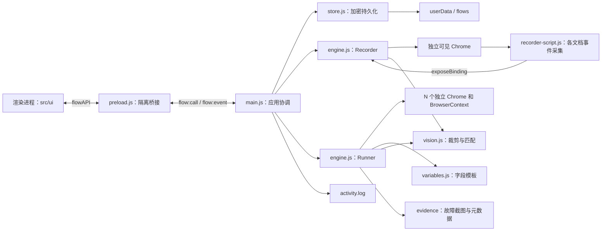
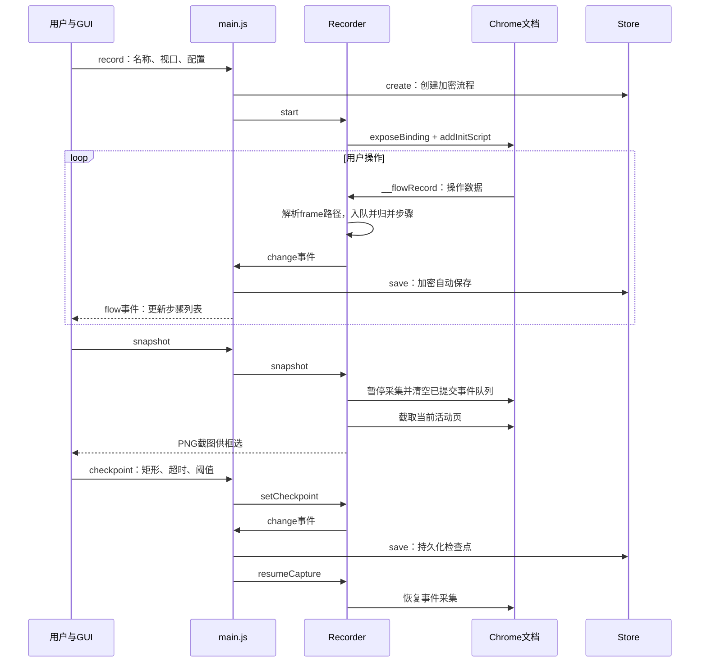
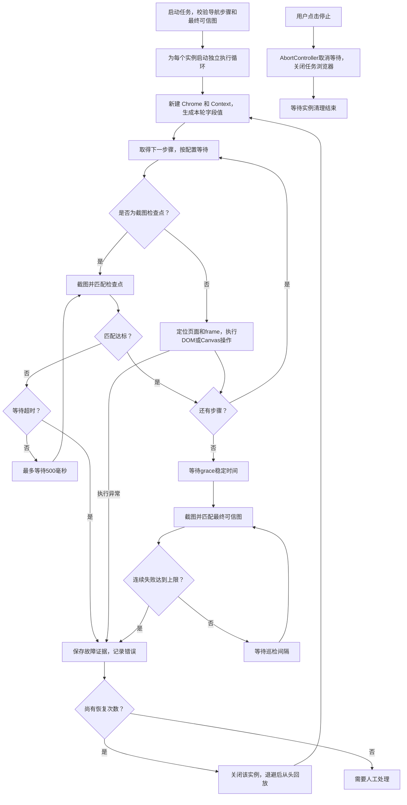

# FlowSentinel 技术架构与源码导航

核对日期：2026-10-23。对应版本：`package.json` 中的 **1.2.0**。本文依据 `D:\code\FlowSentinel` 当前源码整理；正式导航文件为 `AGENTS.md`；`AGEMTS.md` 保留同步副本。

FlowSentinel 是 Windows x64 浏览器操作录制与巡检桌面程序。用户在程序启动的 Chrome 中录制流程，程序保存表单值、操作步骤和可信截图，再以多个独立浏览器实例回放，通过截图检查点等待业务画面就绪，并在最终巡检异常时重建实例。

## 1. 技术栈与进程边界

| 层次 | 技术 | 当前职责 |
| --- | --- | --- |
| 桌面运行时 | Electron 45.0.0 | 主窗口、主进程、IPC、文件对话框、Windows 用户绑定加密 |
| GUI | 原生 HTML / CSS / JavaScript | 深色工作台、配置表单、步骤列表、截图框选、实例状态与滚动日志 |
| 自动化 | playwright-core 1.64.1 | 控制本机 Google Chrome，录制事件、操作 DOM / iframe / Canvas、截图 |
| 图像处理 | pngjs 7.0.0 | PNG 解码、区域裁剪、局部模板匹配 |
| 基础能力 | Node.js 内置模块，CommonJS | 文件持久化、事件、哈希、随机数、UUID、取消信号 |
| 分发 | electron-builder 26.15.3 | Windows x64 portable EXE，ASAR 打包 |
| 测试页面 | Vue，声明版本范围 `^3.5.44` | 仅用于本地表单测试夹具，不是桌面 GUI 框架；精确安装版本以 lock 文件为准 |

没有独立后端服务、数据库、浏览器扩展、OCR 或 AI 图像识别服务。桌面界面来自本地文件；目标网站运行在另行启动的 Chrome 中，不嵌入 Electron 窗口。



关键边界：

- 主进程同一时间只允许一个录制会话或一个运行任务；运行任务内部支持 1–64 个并发实例。
- 每个实例独立调用 `chromium.launch()`，并创建自己的 BrowserContext；不是单个 Chrome 下共享 Cookie 的 N 个标签页。一个实例内部可以包含录制产生的多个标签页。
- 录制与回放使用保存的固定视口、`deviceScaleFactor: 1`、`locale: zh-CN`。默认视口为 1280 × 720。
- `launchOptions()` 默认使用本机 Chrome channel，也支持显式 `chromePath`。无头、静音和禁用后台节流统一在这里配置。
- GUI 的 `contextIsolation` 和 `sandbox` 开启、`nodeIntegration` 关闭。主进程校验 IPC 来源窗口和主框架，GUI 不能直接访问 Node 文件系统。

## 2. 项目目录树与各文件职责

下面覆盖当前源码文件；依赖与测试输出目录单独标明为生成内容。

```text
D:\code\FlowSentinel\
├── AGENTS.md                    本文：技术架构、运行流程与维护导航
├── AGEMTS.md                    历史拼写的同步副本
├── README.md                    用户操作说明、随机模板、运行与排错方法
├── VALIDATION.md                已执行的验收项目、结果及验证范围
├── package.json                 应用入口、依赖、npm 命令、Windows 打包配置
├── package-lock.json            锁定依赖树，供 npm ci 复现安装
├── .gitignore                   排除 node_modules、dist、test-results 和日志
├── LICENSE                      MIT 许可证
├── src/
│   ├── main.js                  Electron 主进程入口、IPC 分派和应用协调
│   ├── preload.js               暴露 window.flowAPI 的最小隔离桥接层
│   ├── engine.js                录制、回放、检查点、并发巡检和自动恢复核心
│   ├── recorder-script.js       注入每个文档的事件录制脚本
│   ├── store.js                 流程对象的加密文件读写、列举与删除
│   ├── variables.js             字段标识、模板校验、整字段和片段随机值生成
│   ├── vision.js                PNG 裁剪与局部图像匹配
│   └── ui/
│       ├── index.html           工作台结构、配置控件和截图选择对话框
│       ├── app.js               GUI 状态、IPC 调用、事件渲染和框选交互
│       ├── style.css            深色主题、布局、组件样式和响应式规则
│       ├── icon.png             主窗口 PNG 图标
│       └── icon.ico             Windows 打包图标
├── test/
│   ├── visual.test.js           点击图像原位、位移、歧义、缺失、取消测试
│   ├── visual-e2e.js            点击前采集、跨域 iframe、不同座位并发回放
│   ├── core.test.js             图像、配置、取消等待、变量和 Store 单元测试
│   ├── fixture.js               Vue 表单和跨源嵌套 iframe / Canvas 测试服务器
│   ├── e2e.js                   真实 Chrome 录制、变量回放、双实例与恢复测试
│   ├── checkpoint-e2e.js        检查点等待、忽略停顿、超时阻断与停止测试
│   ├── ui-smoke.js              源码版及解包版 Electron GUI 验收
│   ├── portable-smoke.js        单文件 EXE 解压启动和基础操作验收
│   └── create-icon.js           生成 src/ui/icon.png 和 icon.ico 的开发脚本
└── dist/
    └── FlowSentinel-1.2.0-win-x64.exe  当前分发产物，不是源码
```

执行安装、构建和测试后，还会产生 `node_modules/`、`test-results/`、`dist/win-unpacked/` 及打包中间文件。目录树中的 EXE 名称对应本次核对版本，后续随版本号变化。

### 2.1 关键模块的内部职责

| 模块 | 主要符号 | 应在这里修改的功能 |
| --- | --- | --- |
| `main.js` | `command()`、`summary()`、`log()`、`status()` | IPC 操作、任务互斥、流程摘要、全局日志、退出清理和文件对话框 |
| `engine.js` | `DEFAULTS`、`config()`、`launchOptions()` | 默认参数、范围校验、Chrome 启动选项 |
| `engine.js` | `Recorder`、`framePath()` | 页面编号、串行录制队列、iframe 路径、截图暂停和自动保存事件 |
| `engine.js` | `Runner`、`replayStep()`、`resolveFrame()` | 多实例执行、步骤分派、iframe 定位、恢复、停止 |
| `engine.js` | `waitForCheckpoint()`、`sleep()` | 检查点轮询、超时和可取消等待 |
| `recorder-script.js` | `installRecorder()` | 元素选择器、输入事件、Canvas 轨迹、滚动和悬停采集 |
| `variables.js` | `fieldId()`、`fields()`、`validateRules()`、`expand()`、`generateValues()` | 字段归一化、模板语法、随机值生命周期 |
| `vision.js` | `crop()`、`match()` | 区域合法性、颜色差异阈值、候选位置搜索与匹配评分 |
| `store.js` | `Store.create/save/get/list/delete` | 持久化格式、文件命名和加密读写 |
| `ui/app.js` | `config()`、`setConfig()`、`renderDetail()`、`renderStates()`、`capture()` | UI 单位换算、状态更新、字段编辑和截图选择 |

## 3. 录制与中途截图检查点



`Recorder` 使用 Promise 队列顺序接收事件，并在相邻的同一字段输入或同一元素滚动时合并步骤。顶层 HTTP(S) 导航另存为 `goto`。录制脚本监听表单输入、点击、键盘、Canvas 指针轨迹及滚轮；滚动采用 120 毫秒防抖，非输入框、非 Canvas 元素悬停 600 毫秒后产生 `hover`。

跨域 iframe 通过 Playwright 向各文档注入脚本独立采集，不依赖顶层网页读取跨域 DOM。框架定位保存从顶层到目标 iframe 的选择器数组；回放依次调用 `contentFrame()` 还原。

Canvas 保存元素选择器及相对元素边框归一化的 `{x, y, t}` 轨迹。回放根据当前边框换算鼠标坐标，保留相邻轨迹点的间隔，但每段最多等待 1000 毫秒。位移超过 8 CSS 像素的拖动保留原轨迹；短点击增加下述图像定位。业务就绪仍需检查点。

截图时记录插入位置 `snapshotIndex`，暂停采集，完成裁剪后将检查点插在该位置。最终可信图保存到 `flow.trusted`，中途可信图保存到对应 `checkpoint` 步骤。保存、取消或 Esc 后恢复录制。暂停的是事件记录，网页动画和业务代码仍继续运行。

## 4. 回放、巡检、恢复与停止



- `Runner.start()` 使用 `Promise.all` 启动实例任务，初次启动按实例编号错开 350 毫秒。
- 默认忽略步骤的录制间隔，使用 `actionInterval`，但仍执行 `hover` 动作。关闭忽略选项后，等待 `min(step.delay, maxStepDelay)`。
- 普通 DOM 操作使用 Playwright 的元素等待。Canvas 可见只表示元素可操作；业务内容就绪需要显式截图检查点。
- 检查点每轮截图匹配后最多睡眠 500 毫秒；实际周期还包括截图和计算耗时。当前一次匹配达标就放行，不要求连续多帧成功。超时不会执行下一步骤，而是进入恢复分支。
- 最终巡检在全部步骤完成、等待 `grace` 后开始。匹配成功清空连续失败计数，失败则累加；达到 `failures` 才触发图像异常恢复。页面关闭或执行异常可以直接触发恢复。
- 恢复关闭当前浏览器，从第一步重新执行；退避时间为 `min(30000, attempts * 2000)` 毫秒。连续五次巡检健康后内部恢复计数归零；达到恢复上限后该实例转为“需要人工处理”，其他实例继续运行。
- `Runner.stop()` 发出取消信号并关闭自身维护的浏览器集合，随后等待所有实例结束。关闭主窗口也会清理录制与执行浏览器。

## 5. 流程数据与随机字段模型

### 5.1 Flow 与 Step

持久化单位是整个 Flow JSON，经加密后写入 `.flow` 文件。

| 字段 | 含义 |
| --- | --- |
| `version` | 流程数据结构版本，当前创建值为 1；不同于应用版本 1.2.0 |
| `id`、`name` | UUID 与用户流程名称 |
| `viewport` | 录制、重放共用的宽高 |
| `config` | 实例数、阈值、等待、恢复和 Chrome 参数 |
| `steps` | 有序操作列表 |
| `trusted` | 最终巡检参考：`rect`、PNG Base64 `image`、`page` |
| `variables` | 可选，以字段 ID 为键的模板配置 |
| `createdAt`、`updatedAt` | 创建与最后保存的 ISO 时间 |

步骤公共字段通常为 `type`、`page`、`frame`、`delay`。页面编号从 0 开始，按 BrowserContext 内页面创建顺序关联；frame 为 iframe 选择器路径。

| 步骤类型 | 特有数据与行为 |
| --- | --- |
| `goto` | `url`；目标不同于当前 URL 时导航，等待 `domcontentloaded` |
| `fill` | `selector`、`value`、`secret`、`fieldName`；回放可能由字段模板替换值 |
| `click` | `selector`、`button`、`count` |
| `check` / `select` | `checked` / `values`，设置勾选或选项 |
| `key` / `hover` | `key` 或目标 `selector` |
| `scroll` | `x`、`y`；selector 为空时滚动窗口 |
| `canvas` | `selector`、`button`、`points` 相对坐标及时间轨迹 |
| `wheel` | 相对位置 `x/y` 与滚动量 `deltaX/deltaY` |
| `checkpoint` | `timeout`、`threshold`、`trusted`；等待可信图出现 |

### 5.2 字段随机值

字段 ID 是 `[page, frame, selector]` 序列化后 SHA-256 的前 20 个十六进制字符。相同页面、框架、选择器的多次填写被视为同一字段。

模板既可占整个字段，例如 `{{int:1000:9999}}`，也可只占片段，例如 `user_{{digits:6}}@example.com`。还支持 `letters`、`uuid` 和 `instance`。`crypto.randomInt()` 提供随机数；随机内容不保证唯一，UUID 更适合需要低碰撞概率的标识。

每个实例每次完整回放生成一组值，同轮同字段复用；自动恢复时重新生成。字段没有模板规则时使用录制原值。登录凭据若需要固定，应继续使用录制原值。

## 6. 图像匹配的实现与边界

`crop()` 将矩形坐标取整，校验边界及至少 12 × 12 像素的尺寸。`match()` 在基准位置附近的容差范围搜索：先稀疏采样排序候选，再对前四个候选周围的邻点做逐像素比较。邻点细化可能比粗搜索边界多延伸 1 像素。

每个像素的 RGB 最大通道差超过 32 视为不一致；评分为 `1 - 不一致像素数 / 总像素数`。返回 `{score, x, y}`。这是颜色容差模板匹配，不做 OCR、语义识别或缩放旋转适配。此处描述检查点的 `match()`；点击定位由单独的 `locateClick()` 实现。

应选稳定、独特的图标内部，避开动态光晕、动画背景和可变文本。单个静态标志仍存在只能证明选定画面存在，不能证明后台业务有心跳。Canvas 布局变化、iframe 路径变化、页面创建顺序变化都可能使旧流程失效。

## 7. 配置默认值与单位

以下为新流程默认值，已有流程可以覆盖；范围校验位于 `engine.js/config()`。

| 配置键 | 默认值 | 内部单位或含义 |
| --- | --- | --- |
| `count` | 1 | 并发浏览器实例，允许 1–64 |
| `interval` | 15 | 巡检间隔，秒 |
| `threshold` | 0.90 | 最终匹配阈值；GUI 显示百分比 |
| `failures` | 3 | 触发恢复的连续巡检失败次数 |
| `retries` | 5 | 恢复次数上限，0 表示不恢复 |
| `grace` | 5 | 全部步骤完成后的稳定等待，秒 |
| `radius` | 12 | 图像位置搜索容差，像素 |
| `stepTimeout` | 15000 | 普通操作及导航超时，毫秒 |
| `maxStepDelay` | 10000 | 保留录制间隔时的单步等待上限，毫秒 |
| `ignoreRecordedDelays` | true | 忽略用户录制时的步骤间停顿 |
| `actionInterval` | 200 | 忽略录制停顿后的步骤间隔，毫秒 |
| `checkpointTimeout` | 60000 | 检查点默认超时，毫秒 |
| `headless`、`mute`、`noThrottle` | true | 无头、静音、禁用后台节流 |
| `chromePath` | 空字符串 | 为空使用 Chrome channel，否则指定可执行文件 |

GUI 对 `stepTimeout`、`maxStepDelay`、`checkpointTimeout` 使用秒输入并转换为毫秒；`actionInterval` 直接输入毫秒。已插入的检查点保存自己的 `timeout` 与 `threshold`，之后修改全局默认值不会覆盖这些独立值。

## 8. IPC、持久化与日志

### 8.1 IPC 接口

`preload.js` 仅暴露 `window.flowAPI.call(action, data)` 与 `onEvent(callback)`。请求通道为 `flow:call`，通常返回 `{ok: true, data}` 或 `{ok: false, error}`；推送通道为 `flow:event`。

| 操作 | 用途 |
| --- | --- |
| `init`、`list` | 读取流程摘要、默认值和当前状态 |
| `record`、`stopRecord` | 开始、结束录制 |
| `snapshot`、`trusted`、`checkpoint`、`cancelCapture` | 获取截图、保存最终基准、插入检查点、取消框选 |
| `config`、`start`、`stop` | 保存参数和变量、启动任务、停止任务 |
| `delete` | 确认后删除流程及故障证据目录 |
| `chrome`、`openData` | 选择 Chrome 路径、打开数据目录 |
| `previewTemplate` | 返回实例 1 的模板生成结果，供调用方预览 |

推送事件包括 `log`、`flow`、`status`、`states`。`summary()` 只将步骤元信息发送给 GUI，不发送步骤中录制的表单原值；字段模板配置与可信图片仍随摘要发送。

### 8.2 本机数据位置

数据根目录来自 `app.getPath('userData')`，通常为 `%APPDATA%\flow-sentinel`，与源码目录分离。测试可用 `FLOW_SENTINEL_TEST_DATA` 指定独立目录。

```text
userData/
├── flows/
│   └── <UUID>.flow                         加密后的完整流程
├── activity.log                           当前运行日志，JSON Lines
├── activity.previous.log                  轮换后的上一份日志
└── evidence/
    └── <流程UUID>/
        ├── instance-<编号>-last-failure.png 最后一次连续图像失败截图
        ├── instance-<编号>-last-error.png   最后一次可获取的执行异常截图
        └── instance-<编号>-last-error.json  步骤、类型、错误类别等元数据
```

`Store.save()` 序列化完整对象，调用 Electron `safeStorage.encryptString()` 加密，先写 `.tmp` 再重命名替换；密码和基准 PNG 同样包含在加密对象内。读取时整体解密。加密绑定当前 Windows 用户，不能将 `.flow` 当作跨机器可移植文件。

界面内存日志最多保留 1500 条，磁盘日志超过 5 MiB 后轮换。回放日志输出步骤类型和错误分类，避免直接写出可能携带输入值的 Playwright 原始调用日志。故障 PNG 和 JSON **没有加密**；截图失败或页面已经关闭时，可能无法生成新截图。

## 9. 开发、打包与验证

在项目目录执行以下 PowerShell 命令。开发需要 Node.js 22.12 或以上及本机 Google Chrome；首次安装需要获取依赖。

```powershell
cd D:\code\FlowSentinel
npm ci
npm start
```

完整验证与打包顺序：

```powershell
cd D:\code\FlowSentinel
npm test
npm run test:e2e
node test/visual-e2e.js
node test/checkpoint-e2e.js
node test/ui-smoke.js
npm run dist
node test/ui-smoke.js --packaged
node test/portable-smoke.js
```

`ui-smoke.js` 需要先运行 `e2e.js` 和 `visual-e2e.js`，生成两种录制夹具。带 `--packaged` 时启动 `dist/win-unpacked/FlowSentinel.exe`。`portable-smoke.js` 启动单文件 EXE，通过仅用于测试的本机 CDP 连接完成验收。测试使用独立数据目录及本地测试站点。

`npm run dist` 生成 Windows x64 便携 EXE，包含 Electron 运行时、`src` 和生产依赖；不包含用户机器上的 Chrome、用户录制数据、测试脚本和测试输出。当前 `signExecutable: false`，不进行可执行文件签名。应用主入口是 `src/main.js`，无需前端编译或独立服务器。

### 9.1 后续修改的关联范围

| 变更任务 | 应同步核对的文件 |
| --- | --- |
| 增加一种操作类型 | `recorder-script.js` 采集；`engine.js` 的 `label/replayStep`；对应 E2E 测试 |
| 增加配置项 | `engine.js` 默认值与校验；`ui/index.html` 控件；`ui/app.js` 单位转换和状态绑定 |
| 新增字段模板语法 | `variables.js`；UI 示例；`core.test.js` 和真实表单回放测试 |
| 修改图像判定 | `vision.js`；单元测试；`checkpoint-e2e.js` 和最终巡检恢复测试 |
| 改动数据格式 | `store.js`、`main.js/summary()`、引擎读取逻辑；核对旧版 `.flow` 兼容性 |
| 新增 GUI 命令 | `main.js/command()`、`ui/app.js`；保持 preload 的接口范围最小化 |
| 发布新版本 | `package.json`、lock 根版本、README、验收说明；检查便携测试脚本中的版本化 EXE 文件名 |

当前没有通用的流程版本迁移器，也没有录制完成后的任意步骤编辑器；旧配置缺省项由 `config()` 合并默认值。不要把直接手工解密改文件作为常规编辑入口。

## 10. 源码依据与阅读路径

| 源码依据（Evidence） | 架构结论（Finding） | 阅读或修改路径（Path） |
| --- | --- | --- |
| `main.js` 的 BrowserWindow、IPC handler 与 `command()` | GUI 和系统操作通过受限 IPC 分离 | 先读 main，再读 preload 和 ui/app |
| `engine.js` 的 `Recorder.start/append/snapshot` | 注入采集、事件归并、框选暂停和自动保存事件协同 | 结合 recorder-script 和 Store 阅读 |
| `Runner.run()` 中每轮 `chromium.launch()` 与 `generateValues()` | 并发实例隔离，恢复重建浏览器并重新生成字段值 | 结合 variables 和恢复分支阅读 |
| `waitForCheckpoint()` 与 `vision.match()` | 用局部模板匹配等待画面，不依赖录制停顿判断就绪 | 结合 checkpoint-e2e 验证超时和停止 |
| `Store.save()` 与主进程 `safeStorage` 注入 | 流程整体加密后落盘，数据独立于源码 | 结合 README 的数据目录说明阅读 |

本文为源码梳理，不新增测试执行结论；已执行的功能验收记录见 [VALIDATION.md](VALIDATION.md)，日常使用说明见 [README.md](README.md)。

## 11. 1.2.0 点击图像定位

- 证据：`recorder-script.js/patch()` 在 Canvas pointerdown 捕获阶段同步读取 48×48 CSS 像素，先于游戏事件处理器；按 Canvas 内部像素与显示尺寸比例采样。保存 `visual.image`（PNG Base64）、`offset`（点击锚点）、`width/height`。
- WebGL：包装 requestAnimationFrame，在回调后最多每 80ms 缓存鼠标附近图像。同步读取为空时，只使用同一 Canvas、同一鼠标位置且小于 250ms 的缓存。跨源污染、透明或缺少图案的截图会保存 `visualError`，界面提示并阻止回放；不悄悄使用空图定位。
- 结论：普通 DOM 点击继续依赖元素选择器；Canvas 短点击先逐像素校验原位置（90%），不通过则在当前页面对应 Canvas 可见范围逐像素搜索。稀疏采样筛选后全像素确认，RGB 通道容差 32；不同候选相距超过 8px 则判歧义。保留点击在图片内的偏移，平移短轨迹。
- 计算每 8 行主动让出事件循环并检查取消信号；各实例只读取自己的页面截图，不访问全桌面、不共享座位偏移。
- `engine.js/canvasBox()` 按 iframe 内容起点累加边框与内边距，修正嵌套 iframe Canvas 坐标。CSS transform 旋转/缩放 iframe 不在支持范围。
- `main.js/summary()` 向 GUI 传递 `visualImage/visualError`；`ui/app.js` 显示 72px 缩略图（源图 48px），不传递表单原值。图像随流程整体加密保存。
- 修改路径：采集改 recorder-script；匹配改 vision；执行及错误处理改 engine；预览改 main 和 ui；测试见 visual.test.js、visual-e2e.js、ui-smoke.js。
- 旧流程没有 visual 时保留旧行为；要启用此能力需重新录制。最终可信图、检查点仍使用局部匹配，建议选不受座位影响的固定标志。
- 限制：不识别座位语义，不支持目标缩放或旋转。相同按钮无法判断所属玩家；原坐标仍匹配时按用户要求优先复用。动画、粒子或变动数字占据截图时可能匹配失败，需要选择稳定图案并设置业务就绪检查点。
