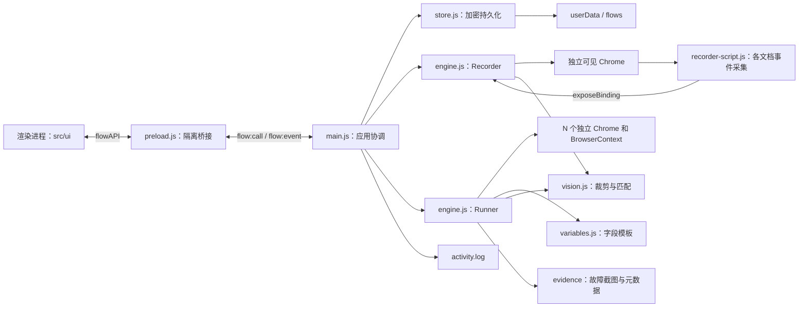
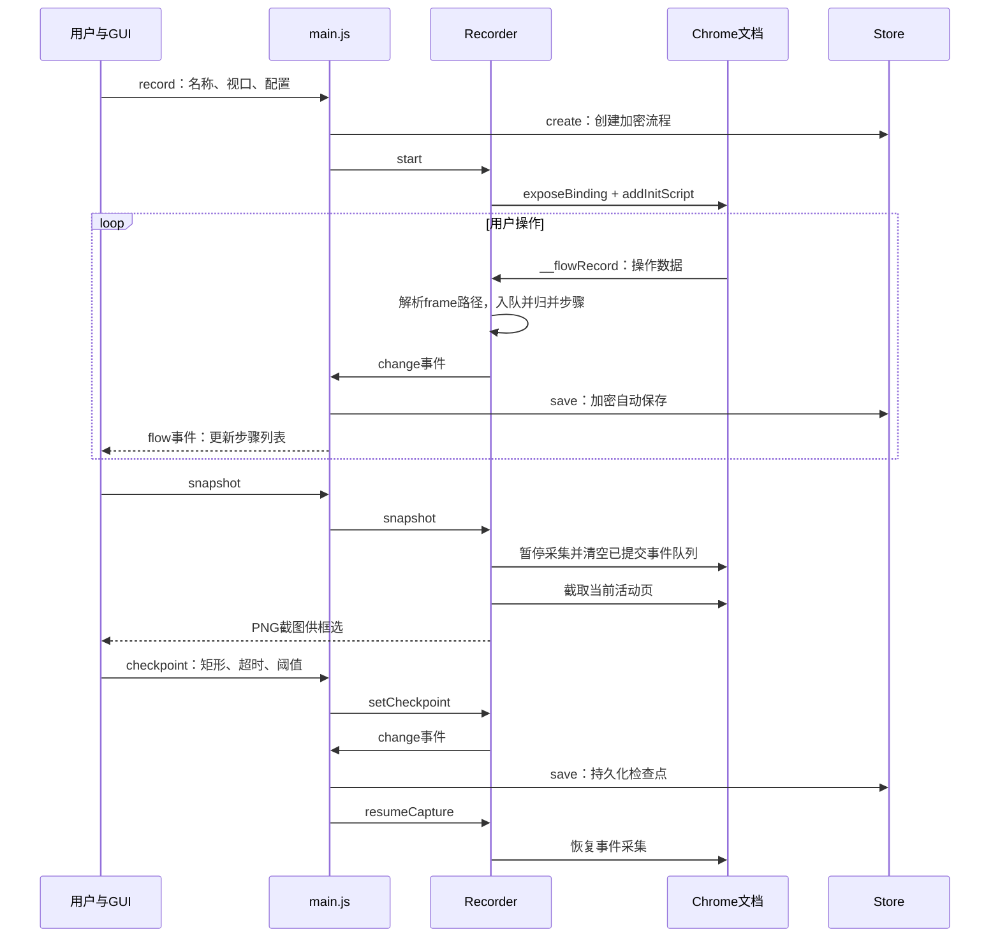
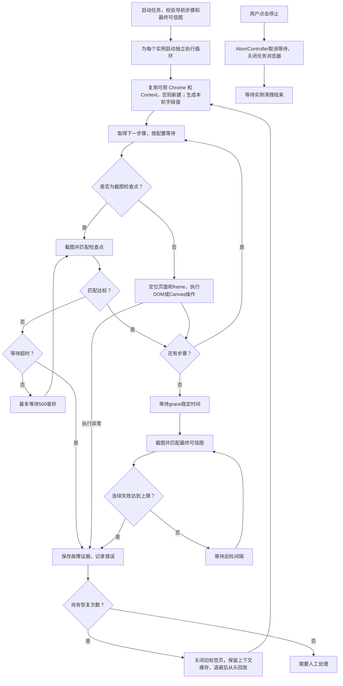

# FlowSentinel 技术架构与源码导航

核对日期：2026-10-26。对应版本：`package.json` 中的 **1.2.9**。本文依据 `D:\ai_code\FlowSentinel` 当前源码整理；正式导航文件为 `AGENTS.md`；

FlowSentinel 是 Windows x64 浏览器操作录制与巡检桌面程序。用户在程序启动的 Chrome 中录制流程，程序保存表单值、操作步骤和可信截图，再以多个独立浏览器实例回放，通过截图检查点等待业务画面就绪，并在巡检异常时优先重建标签页，保留实例缓存。

## 1. 技术栈与进程边界

| 层次 | 技术 | 当前职责 |
| --- | --- | --- |
| 桌面运行时 | Electron 45.0.0 | 主窗口、主进程、IPC、文件对话框、Windows 用户绑定加密 |
| GUI | 原生 HTML / CSS / JavaScript | 浅色 / 暗色 / 适应系统工作台、配置表单、步骤列表、截图框选、实例状态与滚动日志 |
| 自动化 | playwright-core 1.64.1 | 控制本机 Google Chrome，录制事件、操作 DOM / iframe / Canvas、截图 |
| 图像处理 | pngjs 7.0.0 | PNG 解码、区域裁剪、局部模板匹配 |
| 基础能力 | Node.js 内置模块，CommonJS | 文件持久化、事件、哈希、随机数、UUID、取消信号 |
| 分发 | electron-builder 26.15.3 | Windows x64 portable EXE，ASAR 打包 |
| 测试页面 | Vue，声明版本范围 `^3.5.44` | 仅用于本地表单测试夹具，不是桌面 GUI 框架；精确安装版本以 lock 文件为准 |

没有独立后端服务、数据库、浏览器扩展、OCR 或 AI 图像识别服务。桌面界面来自本地文件；目标网站运行在另行启动的 Chrome 中，不嵌入 Electron 窗口。



关键边界：

- 主进程同一时间只允许一个录制会话或一个运行任务；运行任务内部支持 1–64 个并发实例。
- 每个实例独立调用 `chromium.launch()`，并创建自己的 BrowserContext；不是单个 Chrome 下共享 Cookie 的 N 个标签页。一个实例内部可以包含录制产生的多个标签页。
- 录制与回放使用保存的固定视口、`deviceScaleFactor: 1`、`locale: zh-CN`。默认视口为 1280 × 720。
- `launchOptions()` 默认使用本机 Chrome channel，也支持显式 `chromePath`。无头、静音和禁用后台节流统一在这里配置。
- GUI 的 `contextIsolation` 和 `sandbox` 开启、`nodeIntegration` 关闭。主进程校验 IPC 来源窗口和主框架，GUI 不能直接访问 Node 文件系统。

## 2. 项目目录树与各文件职责

下面覆盖当前源码文件；依赖与测试输出目录单独标明为生成内容。

```text
D:\ai_code\FlowSentinel\
├── AGENTS.md                    本文：技术架构、运行流程与维护导航
├── README.md                    用户操作说明、随机模板、运行与排错方法
├── VALIDATION.md                已执行的验收项目、结果及验证范围
├── package.json                 应用入口、依赖、npm 命令、Windows 打包配置
├── package-lock.json            锁定依赖树，供 npm ci 复现安装
├── .gitignore                   排除 node_modules、dist、test-results 和日志
├── LICENSE                      MIT 许可证
├── src/
│   ├── main.js                  Electron 主进程入口、IPC 分派和应用协调
│   ├── preload.js               暴露 window.flowAPI 的最小隔离桥接层
│   ├── engine.js                录制、回放、检查点、并发巡检和自动恢复核心
│   ├── repeat-clicks.js         每轮每实例的连续同点点击坐标复用与失效
│   ├── capture.js               CDP 合成帧缓存与点击前截图兜底
│   ├── recorder-script.js       注入每个文档的事件录制脚本
│   ├── flow-transfer.js         .fs 交换封装、协议/最低版本校验、导入身份与重名规则
│   ├── flow-schema.js           流程数据结构校验，与交换协议隔离
│   ├── store.js                 流程对象的加密文件读写、列举与删除
│   ├── variables.js             字段标识、模板校验、整字段和片段随机值生成
│   ├── vision.js                PNG 裁剪与局部图像匹配
│   └── ui/
│       ├── index.html           工作台结构、配置控件和截图选择对话框
│       ├── app.js               GUI 状态、IPC 调用、事件渲染和框选交互
│       ├── style.css            深色主题、布局、组件样式和响应式规则
│       ├── theme.css            浅色组件配色与主题选择器样式
│       ├── theme.js             首屏主题、系统监听与偏好保存
│       ├── icon.png             主窗口 PNG 图标
│       └── icon.ico             Windows 打包图标
├── test/
│   ├── repeat.test.js           连续点击识别、图像相似与隔离规则单元测试
│   ├── repeat-e2e.js            九次点击、按钮变色、重定位、失效及双实例验收
│   ├── capture.test.js          点击前帧选择、后帧排除和资源释放测试
│   ├── capture-e2e.js           透明叠层、跨域污染 Canvas、低特征图像回归
│   ├── visual.test.js           点击图像原位、位移、歧义、缺失、取消测试
│   ├── visual-e2e.js            点击前采集、跨域 iframe、不同座位并发回放
│   ├── transfer.test.js         交换协议、兼容与重名校验单元测试
│   ├── transfer-smoke.js        源码版/解包版导入导出、重名与跨目录验收
│   ├── core.test.js             图像、配置、取消等待、变量和 Store 单元测试
│   ├── fixture.js               Vue 表单和跨源嵌套 iframe / Canvas 测试服务器
│   ├── e2e.js                   真实 Chrome 录制、变量回放、双实例与恢复测试
│   ├── cache-e2e.js             恢复缓存命中、实例隔离、标签页清理与重启兜底验收
│   ├── checkpoint-e2e.js        检查点等待、忽略停顿、超时阻断与停止测试
│   ├── ui-smoke.js              源码版及解包版 Electron GUI 验收
│   ├── filter-smoke.js          名称筛选、创建与导入更新、空态和主题验收
│   ├── theme-smoke.js           三态主题、系统变化、刷新与重启验收
│   ├── portable-smoke.js        单文件 EXE 解压启动和基础操作验收
│   └── create-icon.js           生成 src/ui/icon.png 和 icon.ico 的开发脚本
└── dist/
    └── FlowSentinel-1.2.9-win-x64.exe  当前分发产物，不是源码
```

执行安装、构建和测试后，还会产生 `node_modules/`、`test-results/`、`dist/win-unpacked/` 及打包中间文件。目录树中的 EXE 名称对应本次核对版本，后续随版本号变化。

### 2.1 关键模块的内部职责

| 模块 | 主要符号 | 应在这里修改的功能 |
| --- | --- | --- |
| `main.js` | `command()`、`summary()`、`log()`、`status()` | IPC 操作、任务互斥、流程摘要、全局日志、退出清理和文件对话框 |
| `engine.js` | `DEFAULTS`、`config()`、`launchOptions()` | 默认参数、范围校验、Chrome 启动选项 |
| `engine.js` | `Recorder`、`framePath()` | 页面编号、串行录制队列、iframe 路径、截图暂停和自动保存事件 |
| `engine.js` | `Runner`、`replayStep()`、`resolveFrame()` | 多实例执行、步骤分派、iframe 定位、恢复、停止 |
| `engine.js` | `waitForCheckpoint()`、`sleep()` | 检查点轮询、超时和可取消等待 |
| `recorder-script.js` | `installRecorder()` | 元素选择器、输入事件、Canvas 轨迹、滚动和悬停采集 |
| `variables.js` | `fieldId()`、`fields()`、`validateRules()`、`expand()`、`generateValues()` | 字段归一化、模板语法、随机值生命周期 |
| `vision.js` | `crop()`、`match()` | 区域合法性、颜色差异阈值、候选位置搜索与匹配评分 |
| `store.js` | `Store.create/save/get/list/delete` | 持久化格式、文件命名和加密读写 |
| `ui/app.js` | `config()`、`setConfig()`、`renderDetail()`、`renderStates()`、`capture()` | UI 单位换算、状态更新、字段编辑和截图选择 |

## 3. 录制与中途截图检查点



`Recorder` 使用 Promise 队列顺序接收事件，并在相邻的同一字段输入或同一元素滚动时合并步骤。顶层 HTTP(S) 导航另存为 `goto`。录制脚本监听表单输入、点击、键盘、Canvas 指针轨迹及滚轮；滚动采用 120 毫秒防抖，非输入框、非 Canvas 元素悬停 600 毫秒后产生 `hover`。

跨域 iframe 通过 Playwright 向各文档注入脚本独立采集，不依赖顶层网页读取跨域 DOM。框架定位保存从顶层到目标 iframe 的选择器数组；回放依次调用 `contentFrame()` 还原。

Canvas 保存元素选择器及相对元素边框归一化的 `{x, y, t}` 轨迹。回放根据当前边框换算鼠标坐标，保留相邻轨迹点的间隔，但每段最多等待 1000 毫秒。位移超过 8 CSS 像素的拖动保留原轨迹；短点击增加下述图像定位。业务就绪仍需检查点。

截图时记录插入位置 `snapshotIndex`，暂停采集，完成裁剪后将检查点插在该位置。最终可信图保存到 `flow.trusted`，中途可信图保存到对应 `checkpoint` 步骤。保存、取消或 Esc 后恢复录制。暂停的是事件记录，网页动画和业务代码仍继续运行。

## 4. 回放、巡检、恢复与停止



- `Runner.start()` 使用 `Promise.all` 启动实例任务，初次启动按实例编号错开 350 毫秒。
- 默认忽略步骤的录制间隔，使用 `actionInterval`，但仍执行 `hover` 动作。关闭忽略选项后，等待 `min(step.delay, maxStepDelay)`。
- 普通 DOM 操作使用 Playwright 的元素等待。Canvas 可见只表示元素可操作；业务内容就绪需要显式截图检查点。
- 检查点每轮截图匹配后最多睡眠 500 毫秒；实际周期还包括截图和计算耗时。当前一次匹配达标就放行，不要求连续多帧成功。超时不会执行下一步骤，而是进入恢复分支。
- 最终巡检在全部步骤完成、等待 `grace` 后开始。匹配成功清空连续失败计数，失败则累加；达到 `failures` 才触发图像异常恢复。页面关闭或执行异常可以直接触发恢复。
- 恢复关闭当前实例全部旧标签页，保留浏览器和 BrowserContext，从新标签页第一步重新执行；浏览器或上下文不可用时才重启；退避时间为 `min(30000, attempts * 2000)` 毫秒。连续五次巡检健康后内部恢复计数归零；达到恢复上限后该实例转为“需要人工处理”，其他实例继续运行。
- `Runner.stop()` 发出取消信号并关闭自身维护的浏览器集合，随后等待所有实例结束。关闭主窗口也会清理录制与执行浏览器。

## 5. 流程数据与随机字段模型

### 5.1 Flow 与 Step

持久化单位是整个 Flow JSON，经加密后写入 `.flow` 文件。

| 字段 | 含义 |
| --- | --- |
| `version` | 流程数据结构版本，当前创建值为 1；不同于应用版本 1.2.9 |
| `id`、`name` | UUID 与用户流程名称 |
| `viewport` | 录制、重放共用的宽高 |
| `config` | 实例数、阈值、等待、恢复和 Chrome 参数 |
| `steps` | 有序操作列表 |
| `trusted` | 最终巡检参考：`rect`、PNG Base64 `image`、`page` |
| `variables` | 可选，以字段 ID 为键的模板配置 |
| `createdAt`、`updatedAt` | 创建与最后保存的 ISO 时间 |

步骤公共字段通常为 `type`、`page`、`frame`、`delay`。页面编号从 0 开始，按 BrowserContext 内页面创建顺序关联；frame 为 iframe 选择器路径。

| 步骤类型 | 特有数据与行为 |
| --- | --- |
| `goto` | `url`；目标不同于当前 URL 时导航，等待 `domcontentloaded` |
| `fill` | `selector`、`value`、`secret`、`fieldName`；回放可能由字段模板替换值 |
| `click` | `selector`、`button`、`count` |
| `check` / `select` | `checked` / `values`，设置勾选或选项 |
| `key` / `hover` | `key` 或目标 `selector` |
| `scroll` | `x`、`y`；selector 为空时滚动窗口 |
| `canvas` | `selector`、`button`、`points` 相对坐标及时间轨迹 |
| `wheel` | 相对位置 `x/y` 与滚动量 `deltaX/deltaY` |
| `checkpoint` | `timeout`、`threshold`、`trusted`；等待可信图出现 |

### 5.2 字段随机值

字段 ID 是 `[page, frame, selector]` 序列化后 SHA-256 的前 20 个十六进制字符。相同页面、框架、选择器的多次填写被视为同一字段。

模板既可占整个字段，例如 `{{int:1000:9999}}`，也可只占片段，例如 `user_{{digits:6}}@example.com`。还支持 `letters`、`uuid` 和 `instance`。`crypto.randomInt()` 提供随机数；随机内容不保证唯一，UUID 更适合需要低碰撞概率的标识。

每个实例每次完整回放生成一组值，同轮同字段复用；自动恢复时重新生成。字段没有模板规则时使用录制原值。登录凭据若需要固定，应继续使用录制原值。

## 6. 图像匹配的实现与边界

`crop()` 将矩形坐标取整，校验边界及至少 12 × 12 像素的尺寸。`match()` 在基准位置附近的容差范围搜索：先稀疏采样排序候选，再对前四个候选周围的邻点做逐像素比较。邻点细化可能比粗搜索边界多延伸 1 像素。

每个像素的 RGB 最大通道差超过 32 视为不一致；评分为 `1 - 不一致像素数 / 总像素数`。返回 `{score, x, y}`。这是颜色容差模板匹配，不做 OCR、语义识别或缩放旋转适配。此处描述检查点的 `match()`；点击定位由单独的 `locateClick()` 实现。

应选稳定、独特的图标内部，避开动态光晕、动画背景和可变文本。单个静态标志仍存在只能证明选定画面存在，不能证明后台业务有心跳。Canvas 布局变化、iframe 路径变化、页面创建顺序变化都可能使旧流程失效。

## 7. 配置默认值与单位

以下为新流程默认值，已有流程可以覆盖；范围校验位于 `engine.js/config()`。

| 配置键 | 默认值 | 内部单位或含义 |
| --- | --- | --- |
| `count` | 1 | 并发浏览器实例，允许 1–64 |
| `interval` | 15 | 巡检间隔，秒 |
| `threshold` | 0.90 | 最终匹配阈值；GUI 显示百分比 |
| `failures` | 3 | 触发恢复的连续巡检失败次数 |
| `retries` | 5 | 恢复次数上限，0 表示不恢复 |
| `grace` | 5 | 全部步骤完成后的稳定等待，秒 |
| `radius` | 12 | 图像位置搜索容差，像素 |
| `stepTimeout` | 15000 | 普通操作及导航超时，毫秒 |
| `maxStepDelay` | 10000 | 保留录制间隔时的单步等待上限，毫秒 |
| `ignoreRecordedDelays` | true | 忽略用户录制时的步骤间停顿 |
| `actionInterval` | 200 | 忽略录制停顿后的步骤间隔，毫秒 |
| `checkpointTimeout` | 60000 | 检查点默认超时，毫秒 |
| `headless`、`mute`、`noThrottle` | true | 无头、静音、禁用后台节流 |
| `chromePath` | 空字符串 | 为空使用 Chrome channel，否则指定可执行文件 |

GUI 对 `stepTimeout`、`maxStepDelay`、`checkpointTimeout` 使用秒输入并转换为毫秒；`actionInterval` 直接输入毫秒。已插入的检查点保存自己的 `timeout` 与 `threshold`，之后修改全局默认值不会覆盖这些独立值。

## 8. IPC、持久化与日志

### 8.1 IPC 接口

`preload.js` 仅暴露 `window.flowAPI.call(action, data)` 与 `onEvent(callback)`。请求通道为 `flow:call`，通常返回 `{ok: true, data}` 或 `{ok: false, error}`；推送通道为 `flow:event`。

| 操作 | 用途 |
| --- | --- |
| `init`、`list` | 读取流程摘要、默认值和当前状态 |
| `record`、`stopRecord` | 开始、结束录制 |
| `snapshot`、`trusted`、`checkpoint`、`cancelCapture` | 获取截图、保存最终基准、插入检查点、取消框选 |
| `config`、`start`、`stop` | 保存参数和变量、启动任务、停止任务 |
| `delete` | 确认后删除流程及故障证据目录 |
| `chrome`、`openData` | 选择 Chrome 路径、打开数据目录 |
| `previewTemplate` | 返回实例 1 的模板生成结果，供调用方预览 |

推送事件包括 `log`、`flow`、`status`、`states`。`summary()` 只将步骤元信息发送给 GUI，不发送步骤中录制的表单原值；字段模板配置与可信图片仍随摘要发送。

### 8.2 本机数据位置

数据根目录来自 `app.getPath('userData')`，通常为 `%APPDATA%\flow-sentinel`，与源码目录分离。测试可用 `FLOW_SENTINEL_TEST_DATA` 指定独立目录。

```text
userData/
├── flows/
│   └── <UUID>.flow                         加密后的完整流程
├── activity.log                           当前运行日志，JSON Lines
├── activity.previous.log                  轮换后的上一份日志
└── evidence/
    └── <流程UUID>/
        ├── instance-<编号>-last-failure.png 最后一次连续图像失败截图
        ├── instance-<编号>-last-error.png   最后一次可获取的执行异常截图
        └── instance-<编号>-last-error.json  步骤、类型、错误类别等元数据
```

`Store.save()` 序列化完整对象，调用 Electron `safeStorage.encryptString()` 加密，先写 `.tmp` 再重命名替换；密码和基准 PNG 同样包含在加密对象内。读取时整体解密。加密绑定当前 Windows 用户，不能将 `.flow` 当作跨机器可移植文件。

界面内存日志最多保留 1500 条，磁盘日志超过 5 MiB 后轮换。回放日志输出步骤类型和错误分类，避免直接写出可能携带输入值的 Playwright 原始调用日志。故障 PNG 和 JSON **没有加密**；截图失败或页面已经关闭时，可能无法生成新截图。

## 9. 开发、打包与验证

在项目目录执行以下 PowerShell 命令。开发需要 Node.js 22.12 或以上及本机 Google Chrome；首次安装需要获取依赖。

```powershell
cd D:\ai_code\FlowSentinel
npm ci
npm start
```

完整验证与打包顺序：

```powershell
cd D:\ai_code\FlowSentinel
npm test
npm run test:e2e
node test/visual-e2e.js
node test/capture-e2e.js
node test/repeat-e2e.js
node test/checkpoint-e2e.js
node test/ui-smoke.js
npm run dist
node test/ui-smoke.js --packaged
node test/portable-smoke.js
```

`ui-smoke.js` 需要先运行 `e2e.js` 和 `visual-e2e.js`，生成两种录制夹具。带 `--packaged` 时启动 `dist/win-unpacked/FlowSentinel.exe`。`portable-smoke.js` 启动单文件 EXE，通过仅用于测试的本机 CDP 连接完成验收。测试使用独立数据目录及本地测试站点。

`npm run dist` 生成 Windows x64 便携 EXE，包含 Electron 运行时、`src` 和生产依赖；不包含用户机器上的 Chrome、用户录制数据、测试脚本和测试输出。当前 `signExecutable: false`，不进行可执行文件签名。应用主入口是 `src/main.js`，无需前端编译或独立服务器。

### 9.1 后续修改的关联范围

| 变更任务 | 应同步核对的文件 |
| --- | --- |
| 增加一种操作类型 | `recorder-script.js` 采集；`engine.js` 的 `label/replayStep`；对应 E2E 测试 |
| 增加配置项 | `engine.js` 默认值与校验；`ui/index.html` 控件；`ui/app.js` 单位转换和状态绑定 |
| 新增字段模板语法 | `variables.js`；UI 示例；`core.test.js` 和真实表单回放测试 |
| 修改图像判定 | `vision.js`；单元测试；`checkpoint-e2e.js` 和最终巡检恢复测试 |
| 改动数据格式 | `store.js`、`main.js/summary()`、引擎读取逻辑；核对旧版 `.flow` 兼容性 |
| 新增 GUI 命令 | `main.js/command()`、`ui/app.js`；保持 preload 的接口范围最小化 |
| 发布新版本 | `package.json`、lock 根版本、README、验收说明；检查便携测试脚本中的版本化 EXE 文件名 |

当前没有通用的流程版本迁移器，也没有录制完成后的任意步骤编辑器；旧配置缺省项由 `config()` 合并默认值。不要把直接手工解密改文件作为常规编辑入口。

## 10. 源码依据与阅读路径

| 源码依据（Evidence） | 架构结论（Finding） | 阅读或修改路径（Path） |
| --- | --- | --- |
| `main.js` 的 BrowserWindow、IPC handler 与 `command()` | GUI 和系统操作通过受限 IPC 分离 | 先读 main，再读 preload 和 ui/app |
| `engine.js` 的 `Recorder.start/append/snapshot` | 注入采集、事件归并、框选暂停和自动保存事件协同 | 结合 recorder-script 和 Store 阅读 |
| `Runner.run()` 中条件式 `chromium.launch()` 与每轮 `generateValues()` | 并发实例隔离，恢复优先复用上下文缓存并重新生成字段值 | 结合 variables 和恢复分支阅读 |
| `waitForCheckpoint()` 与 `vision.match()` | 用局部模板匹配等待画面，不依赖录制停顿判断就绪 | 结合 checkpoint-e2e 验证超时和停止 |
| `Store.save()` 与主进程 `safeStorage` 注入 | 流程整体加密后落盘，数据独立于源码 | 结合 README 的数据目录说明阅读 |

本文为源码梳理，不新增测试执行结论；已执行的功能验收记录见 [VALIDATION.md](VALIDATION.md)，日常使用说明见 [README.md](README.md)。

## 11. 1.2.0 点击图像定位

- 证据：`recorder-script.js/patch()` 在 Canvas pointerdown 捕获阶段同步读取 48×48 CSS 像素，先于游戏事件处理器；按 Canvas 内部像素与显示尺寸比例采样。保存 `visual.image`（PNG Base64）、`offset`（点击锚点）、`width/height`。
- 1.2.0 曾包装 requestAnimationFrame 缓存鼠标附近图像；1.2.1 已移除此实现，改用下一节的浏览器合成画面兜底。
- 结论：普通 DOM 点击继续依赖元素选择器；Canvas 短点击先逐像素校验原位置（90%），不通过则在当前页面对应 Canvas 可见范围逐像素搜索。稀疏采样筛选后全像素确认，RGB 通道容差 32；不同候选相距超过 8px 则判歧义。保留点击在图片内的偏移，平移短轨迹。
- 计算每 8 行主动让出事件循环并检查取消信号；各实例只读取自己的页面截图，不访问全桌面、不共享座位偏移。
- `engine.js/canvasBox()` 按 iframe 内容起点累加边框与内边距，修正嵌套 iframe Canvas 坐标。CSS transform 旋转/缩放 iframe 不在支持范围。
- `main.js/summary()` 向 GUI 传递 `visualImage/visualError`；`ui/app.js` 显示 72px 缩略图（源图 48px），不传递表单原值。图像随流程整体加密保存。
- 修改路径：采集改 recorder-script；匹配改 vision；执行及错误处理改 engine；预览改 main 和 ui；测试见 visual.test.js、visual-e2e.js、ui-smoke.js。
- 旧流程没有 visual 时保留旧行为；要启用此能力需重新录制。最终可信图、检查点仍使用局部匹配，建议选不受座位影响的固定标志。
- 限制：不识别座位语义，不支持目标缩放或旋转。相同按钮无法判断所属玩家；原坐标仍匹配时按用户要求优先复用。动画、粒子或变动数字占据截图时可能匹配失败，需要选择稳定图案并设置业务就绪检查点。

## 12. 1.2.1 大厅截图误判修复

### 证据与修复路径

只读检查用户指定的“自动化 ParadiseFishing”：第 68–71 步均有 visualError 且没有 visual，第 72–81 步有 visual。故障证据截图清晰显示大厅按钮，因此旧版“空白或无法读取”将读取失败与真实空白混为一谈。保存的数据不能进一步区分缓冲区清空、跨源污染或图层透明。

新增 `capture.js/ClickCapture`：录制期间每个 Page 建立独立 CDP 会话，订阅 PNG 合成帧，内存最多保留 6 帧。导航清空缓存，DOMContentLoaded 后重启流。停止录制时 detach 并清空。完整页面帧不写入流程或磁盘。

`recorder-script.js` 仍在 pointerdown 前置监听中优先同步读取 Canvas；读回不可用时立即调用 `__flowVisual`，携带点击时间、文档内坐标和当时 Canvas 矩形。`ClickCapture.capture()` 在 await 前锁定时间戳不晚于点击的最新合成帧，再累加 iframe 边框及内边距换算顶层坐标，裁出 48×48 PNG。禁止用点击后截图替代，禁止为获取图像重发业务点击。首帧缺失或截图比例异常会明确提示重新录制。

`send(data, visualPromise)` 将图像结果合并到原有串行录制队列，`__flowFlush` 会等待；拖动不等待或保存视觉模板。新增 visual.source=compositor 标明兜底来源。可读但缺少图案的图片仍显示缩略图，同时设置“图案特征不足”错误，1.2.1 时回放会阻断；1.2.2 改为回退录制原坐标，匹配阈值不降低。

此变更不自动修复旧流程中已经丢失的图片，也不改写用户原流程。若希望缺失截图的步骤也能图像重定位，需要重新录制；1.2.2 可直接按原坐标回放这些步骤。代码维护路径：采集服务 capture.js；绑定/生命周期 engine.js；前端事件和队列 recorder-script.js；测试 capture.test.js、capture-e2e.js、visual-e2e.js。

## 13. 1.2.2 点击回退策略

不新增模块或依赖，回放决策变更位于 `engine.js/replayStep()`。优先级为：原位置图像匹配→原位点击；原位不匹配且画布中找到唯一目标→点击新坐标；未找到或存在多个目标→使用该步骤录制的原坐标。搜索范围仍为当前实例的目标 Canvas 可见部分。匹配器 `locateClick()` 继续用 VISUAL_NOT_FOUND / VISUAL_AMBIGUOUS / VISUAL_INVALID 表达定位结果，回放层捕获这三类结果并回退。

原坐标每步从保存的归一化 points 和当前画布位置重新计算，不覆盖录制数据；独立点击不沿用上一操作的偏移，1.2.3 对连续同点点击增加下一节的有限复用。参考图缺失、旧 visualError、图像格式损坏和截图失败也按原坐标继续。停止信号、页面关闭和真正的鼠标/元素操作错误仍中止执行，不被回退逻辑吞掉。

`onVisual(message, level)` 向 Runner 提供 info/warn 日志，保留实例编号与步骤日志，记录匹配/重定位结果、回退原因及坐标。UI 的截图错误附带“回放时使用录制原坐标”，不再暗示该步骤必然终止流程。中途截图检查点和最终巡检的失败/恢复策略不变。

证据与维护路径：visual.test.js 验证匹配分类；visual-e2e.js 验证并发原位/位移、缺失/重复/损坏/旧 visualError 回退坐标、warn 日志、后续表单继续和取消不点击；ui-smoke.js 与 portable-smoke.js 验证打包交付。

## 14. 1.2.3 连续同点点击

### 证据与行为

只读比对“自动化 ParadiseFishing”第 68–76 步：共 9 个 Canvas 点击、坐标相同、间隔约 264–350ms（首击前为 806ms）。按既有 RGB 容差 32 计算，九张 48×48 图的像素一致率为 99.9566%–100%，因此未发现录制图逐次变形。旧回放每步独立匹配、且不保存首次重定位坐标；按钮的点击后视觉状态变化会使后续失配并退回旧座位。现有日志无法单独确定真实游戏是悬停还是按压状态变化；回归测试通过首次点击后改变图案复现了这一执行缺陷。

新增 `repeat-clicks.js/RepeatClicks`，由 Runner 在每个实例、每轮完整回放创建，作为 replayStep 的可选第五参数。首击仍遵循原位→画布唯一目标→原坐标回退优先级。只有图像匹配通过且鼠标动作成功的短点击会建立本段锚点。后续同点点击复用锚点，无需重新截图，日志输出连续次数、已确认坐标和录制坐标；仍逐个执行 down/up，未合并或省略点击。首次回退坐标不会被当成已确认锚点。

### 识别和清理边界

要求同一 page/frame/selector/button 与同一个 Canvas DOM 元素；画布矩形各项差异小于 0.5px；原点击位置相差不超过 1px；图像相对首击模板一致率至少 98%（RGB 容差 32），图内偏移差不超过 1px；当前保存间隔不超过 1500ms，上次成功动作结束至本次不超过 5000ms。轨迹位移超过 8px、按压超过 1000ms、缺图或 visualError 均不参与。每次比较固定使用本段首击基准，避免累计漂移。

换位置/图案、非 Canvas 步骤、检查点、长间隔、Canvas 替换或矩形变化都会清理；鼠标失败、停止及恢复重建也释放 ElementHandle。回放不改写录制文件，旧流程可直接使用。不同实例及恢复轮次互不共享锚点。

源码维护路径：repeat-clicks.js 管理识别与生命周期；engine.js 负责首次定位、鼠标完成后提交及 Runner 清理；repeat.test.js 验证边界；repeat-e2e.js 验证首次重定位后图案改变仍完成九下，以及双实例不同座位各自九下。

## 15. 1.2.4 点击模板外围干扰修复

可见模式实际复现 ParadiseFishing 第 68–76 步全部首次定位失败：录制模板底部包含滚动条，外围背景也有变化；第 68 步完整图一致率 78.73%，中央 32×32 区域一致率 100%。1.2.3 的复用只在首次匹配成功后启动，因此未解决这个真实首击失配。

vision.js/locateClick 保留完整 48×48 原位校验和画布搜索。只有完整图无候选时，才检测中央 32×32 的图案特征，按相同 90% 阈值和 RGB 容差 32 重试原位及画布搜索；返回 region=center。完整图的多候选结果不被中央匹配覆盖；中央区域低特征、无候选或多候选仍按原规则回退。engine.js 输出中央特征匹配日志，成功后沿用 RepeatClicks 的逐次点击及隔离逻辑。截图检查点、流程数据格式和模块目录不变，无需重录。

测试维护路径：visual.test.js 新增外围变化、中央重定位、多候选与平坦中心回归；真实运行证据仅位于忽略目录 test-results，不打包用户数据。

## 16. 1.2.5 无头巡检日志截图

- `engine.js/Runner.run()` 在最终巡检日志中附带本次匹配使用的完整视口 PNG，仅在 `cfg.headless` 为真时发送；成功和连续失败均附图，各实例沿用自己的目标页面截图，不增加截图请求。
- `main.js/log(level,message,image)` 通过既有 `flow:event` 和 `init.logs` 提供图片及保留标记。主进程和 GUI 各自最多保留最近 64 张图片，Data URL 字符总量上限 24 MiB（ASCII 编码大小，不含解码像素内存）；超限释放较早图片并保留文字。文字日志仍最多 1500 条。
- `ui/app.js/addLog()` 显示 160×90 缩略图；`index.html/logImageDialog` 与 `style.css` 提供独立放大对话框，点击大图可切换原始尺寸，关闭按钮或 Esc 退出并释放大图引用。缩略图保留整幅比例，不裁掉页面内容。
- 日志截图仅在应用内存中保留，退出应用后不保留；`activity.log` 仍只写时间、级别和消息。故障证据的原有落盘行为不变。截图是最终可信图所在页面的视口，不是桌面或所有标签页。
- 沿用现有进程、IPC 和文件目录，无新模块、依赖或流程数据字段。维护路径：engine → main → ui；`test/e2e.js` 验证无头成功/失败带图和有头不带图，`test/ui-smoke.js` 验证缩略图、放大、关闭、刷新恢复和图片保留数量。


## 17. 1.2.6 浅色与系统主题

- 顶栏 themeSelect 提供浅色、暗色、适应系统，默认适应系统。暗色保留原配色，浅色覆盖卡片、表单、日志、状态、截图容器和弹窗；截图像素本身不变。
- ui/theme.js 在 head 中同步加载，在正文绘制前设置根节点 data-theme；matchMedia 监听系统颜色变化，仅适应系统时跟随。手动模式不受系统切换影响。
- 偏好保存于渲染进程 localStorage 的 flow-sentinel-theme，刷新与重启后恢复；非法值回退系统，存储不可用时支持会话内切换。不写入 Flow，不新增 IPC 或依赖。
- Evidence → Finding → Path：theme.js 的偏好恢复与系统监听 → UI 独立管理外观 → 修改行为读 theme.js，修改浅色配色读 theme.css，入口读 index.html。theme-smoke.js 验证三态切换、模拟系统变化、刷新/重启持久化和布局。
- 验证命令：node test/theme-smoke.js；打包后 node test/theme-smoke.js --packaged。进程架构和录制回放逻辑不变，目录树已补充两个 UI 文件和主题验收脚本。

## 18. 1.2.7 流程导入导出

- Evidence → Finding → Path：flow-transfer.js 的 encode/decode → 独立交换协议不依赖步骤类型或本机加密 → 协议改此模块；flow-schema.js 校验内部数据；main.js 协调文件对话框、待导入对象及 Store；ui/app.js 管理重命名交互。
- .fs 为 UTF-8 JSON，封装 format=FlowSentinel、protocolVersion=1、minImporterVersion=1.2.7、exporterVersion 和完整 flow。128 MiB 上限。它是未加密的便携文件，包含表单原值和图片；导入后重新使用目标 Windows 用户的 safeStorage 加密。
- 导出使用已保存流程，原生保存对话框默认 app.getPath('downloads')，允许修改目录；导入使用原生打开对话框。IPC 新增 exportFlow、prepareImport、confirmImport、cancelImport；录制/任务期间禁止导入导出。
- prepareImport 校验封装和数据后仅在主进程内存保存待导入流程，向 GUI 返回名称和已有名称。确认前不落盘；取消或下次选文件清理待导入对象。确认时重新检查名称、生成 UUID、重置创建/更新时间，以新流程保存，不覆盖原流程。
- 输入实时检查空白、80 字符和重名，重名比较去除首尾空白、NFKC 归一化并忽略大小写；主进程再次校验，避免绕过 UI。导入后选中新流程，不自动启动。
- 同协议且达到最低导入版本时接收；较新的 exporterVersion 本身不造成拒绝。不兼容协议或未达到最低版本时拒绝并显示文件声明的最低导入版本。1.2.6 及以前没有导入入口，需要升级到 1.2.7。
- 后续引入旧版无法理解的必需字段或步骤时，必须提高 MIN_VERSION；破坏封装兼容时提高 PROTOCOL，并为需支持的旧协议提供解码适配。不得只提高应用版本而漏改兼容声明。流程字段完整保留，数据结构校验集中在 flow-schema.js；本机 .flow 格式和 Store 不变。
- 验证：npm test；node test/transfer-smoke.js；打包后 node test/transfer-smoke.js --packaged。对话框在自动测试中替换返回值，真实 Electron IPC、界面、加密 Store 均运行；跨机器以两个独立数据目录模拟。

## 19. 1.2.8 恢复时保留实例缓存

- Evidence → Finding → Path：engine.js/Runner.run() 将 browser/context 生命周期提升到实例循环外，逐轮移除 page 监听器并关闭所有旧页 → 浏览器可用时复用同一上下文 HTTP 缓存，page 编号每轮从 0 开始 → 恢复与清理行为维护于 engine.js；缓存请求计数和失效兜底验证于 test/cache-e2e.js。
- 自动恢复不清理 Cookie、localStorage、IndexedDB 等上下文数据；sessionStorage 随页面关闭释放。登录态可能保留，流程需兼容已有登录态。随机字段和 RepeatClicks 仍每轮重新建立，不同实例不共享缓存或会话。
- 旧页（包括弹出页）关闭时不触发 beforeunload。关闭失败、首个新页面创建失败、上下文关闭或浏览器断开时，下轮重启浏览器。停止、退出和达到恢复上限时最终关闭实例，缓存不跨任务持久化。
- 遵循网站 HTTP 缓存策略，不保证 no-store、过期或已淘汰资源命中；不读取用户日常 Chrome 配置，不实现跨进程共享缓存。无新增生产模块、依赖、IPC 或流程字段，旧流程无需重录。
- 验证命令：node test/cache-e2e.js；npm test；node test/e2e.js；node test/checkpoint-e2e.js。

## 20. 1.2.9 流程名称筛选

- Evidence → Finding → Path：ui/app.js/renderList() 对完整 flows 按名称包含关系派生可见列表 → 仅渲染进程筛选，不改变选择、持久化及任务 → 控件维护于 ui/index.html，布局维护于 ui/style.css，行为维护于 ui/app.js。
- 名称和查询均 trim、NFKC 归一化并转小写；空查询显示全部。输入即时刷新，清空按钮及 Esc 重置，展示匹配数 / 总数与无结果提示。新增、导入、删除和 flow 事件仍通过 renderList 应用当前条件。
- 无新增生产模块、依赖、IPC 或流程字段；目录树补充 test/filter-smoke.js。筛选仅保留在窗口内，刷新后重置。
- 验证命令：node test/filter-smoke.js；node test/filter-smoke.js --packaged。覆盖真实 Chrome 创建、真实 IPC 导入后的筛选更新、中文/大小写/全角、空白、无结果、清空、选择保留和两种主题。
